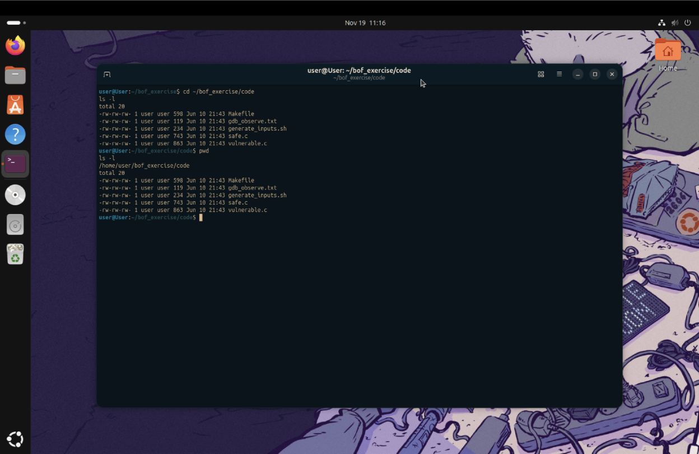
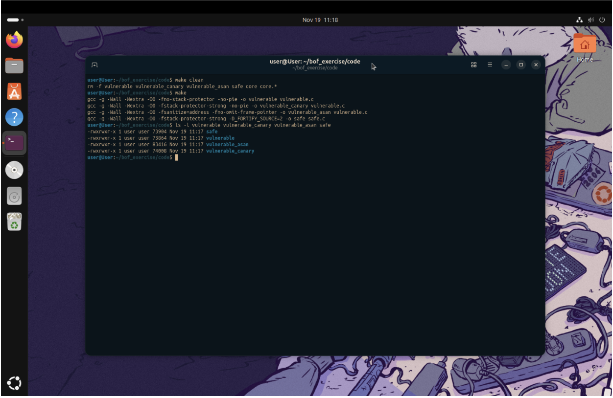
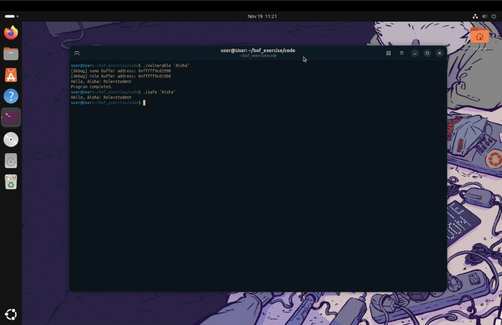
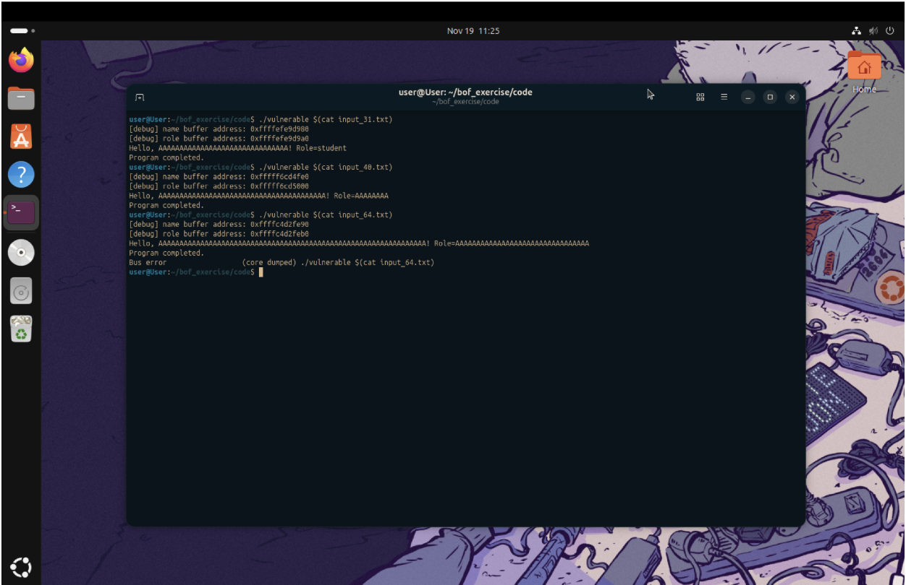
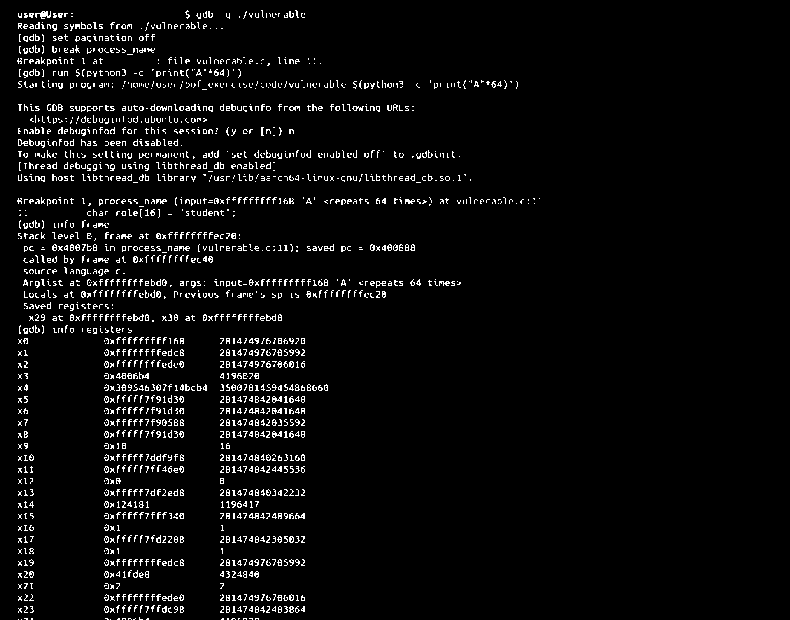
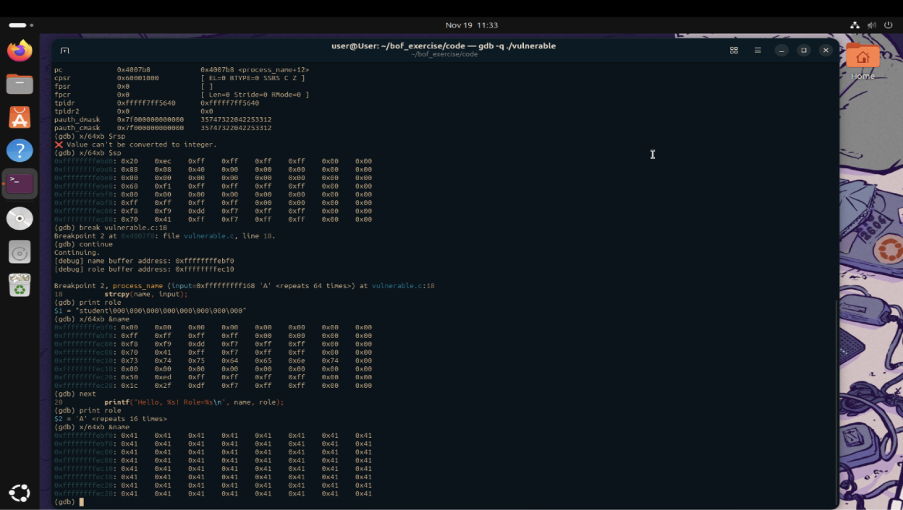
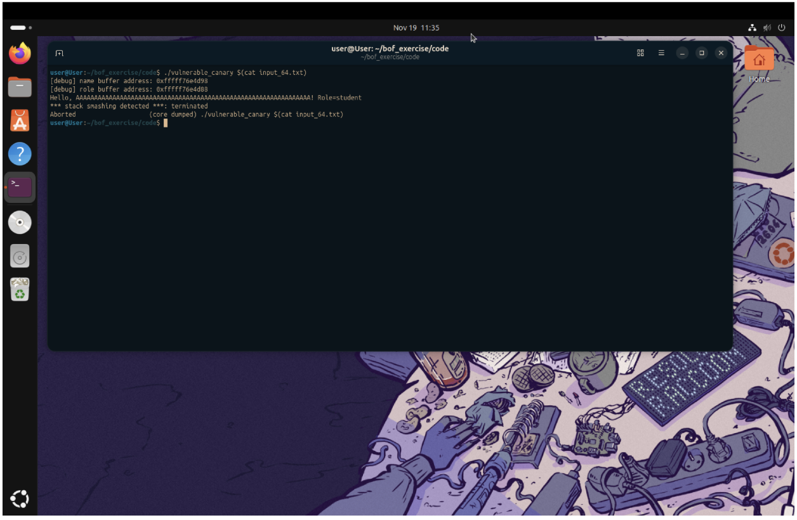
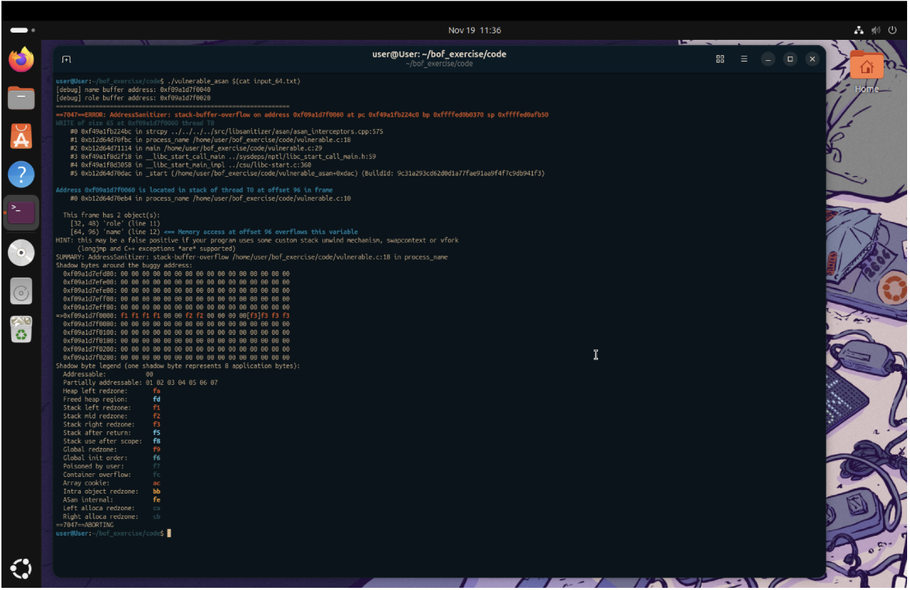
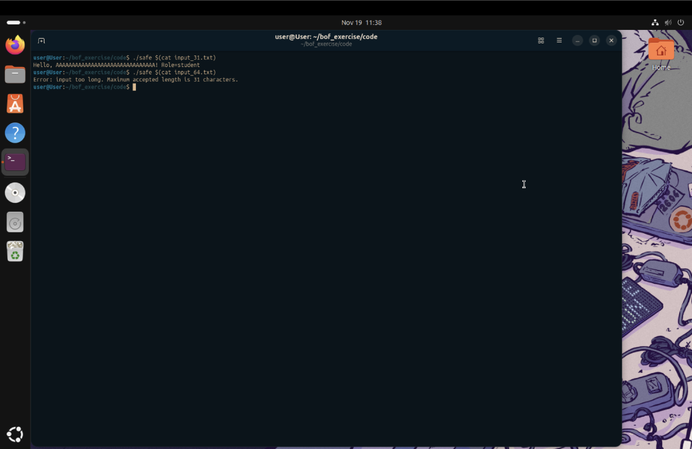

# CYSE 211 — Lab 6: Buffer Overflow & Secure Coding

> **Course:** CYSE 211 — Operating Systems  
> **Student:** Harshith Motipalli  
> **Instructor:** Professor Gebril  
> **Environment:** Isolated Ubuntu virtual machine (ARM64), GCC, GDB, GNU Make, AddressSanitizer

## Summary

This lab investigates **stack-based buffer overflows in C** and compares the behavior of four builds: a deliberately vulnerable program, a stack-canary-protected build, an AddressSanitizer-instrumented build, and a length-validated safe version. The experiments demonstrate how an oversized argument can corrupt an adjacent stack variable or crash a process, how development tools identify the out-of-bounds write, and how input validation and bounded copying prevent it.

The work is an **educational exercise in an isolated VM**. It does not demonstrate unauthorized access to an external system.

## At a Glance

| Item | Details |
| --- | --- |
| Vulnerability class | Stack-based buffer overflow (CWE-121) |
| Primary cause | Unbounded `strcpy()` into a 32-byte character buffer |
| Tools | Ubuntu VM, `gcc`, `make`, `gdb`, AddressSanitizer |
| Builds compared | `vulnerable`, `vulnerable_canary`, `vulnerable_asan`, `safe` |
| Test data | 8, 31, 32, 40, 64, 96, and 128-character inputs |
| Notable observation | Overflow altered the neighboring `role` field; longer input caused a bus error |
| Defensive result | Stack canary reported stack smashing; ASan pinpointed an out-of-bounds write; safe version rejected long input |
| Evidence | 10 terminal screenshots |

## Assessment Workflow & Evidence

### Task 1 — Prepare and inspect the lab environment

Located the working directory (`~/bof_exercise/code`) and verified the supplied files, including the `Makefile`, `generate_inputs.sh`, `vulnerable.c`, and `safe.c`. The lab was run within an isolated virtual machine to contain intentional memory-corruption experiments.



### Task 2 — Build the four program variants

Used `make clean` and `make` to compile the vulnerable, stack-canary, AddressSanitizer, and safe executables. This created a controlled comparison of behavior with and without runtime and compile-time protections.



### Task 3 — Establish a safe-input baseline

Executed both the vulnerable and safe versions with `Aisha`. Both completed successfully and reported `Role=student` because the name fits within the input buffer.



### Task 4 — Generate boundary and oversized test inputs

Generated test files of various lengths (8, 31, 32, 40, 64, 96, and 128 characters). With a 32-byte C string buffer, only **31 non-null characters** fit safely because a final byte is needed for `\0`.


### Task 5 — Observe corruption in the unprotected executable

Passed increasing input lengths to `vulnerable`. The 31-character case completed normally. A 40-character input overwrote the `role` variable, changing it from `student` to repeated `A` characters. The 64-character test produced corrupted output and a `Bus error (core dumped)` message.



### Task 6 — Investigate stack memory with GDB

Used GDB breakpoints, stack-frame inspection, CPU-register output, and memory dumps to inspect the program before and after the unsafe copy. The `role` value changed from `student` to repeated `A` characters; the value `0x41` in the memory dump represents ASCII `A`.





### Task 7 — Compare stack-canary protection

Ran `vulnerable_canary` with the long input. The runtime emitted `stack smashing detected` and terminated the process rather than allowing the corrupted stack frame to return normally. The canary is a **detection/mitigation mechanism**, not a replacement for correct input validation.



### Task 8 — Locate the defect with AddressSanitizer

Ran `vulnerable_asan` with the 64-character test. ASan reported `stack-buffer-overflow` in `process_name()` at `vulnerable.c:18`, identifying an out-of-bounds copy into the 32-byte `name` buffer. A 64-character C string needs 65 bytes including its null terminator.



### Task 9 — Test secure input handling

Ran `safe` with boundary and oversized test inputs. The 31-character string was accepted, while 64 characters were rejected with an input-length error. The secure-coding implementation uses length validation and bounded copying to prevent corruption.



### Task 10 — Connect the lab to real-world CVEs

The coursework identifies the following examples of software vulnerabilities related to buffer handling and memory corruption:

| CVE | Product / component | Mitigation listed in lab report |
| --- | --- | --- |
| CVE-2022-4634 | Delta Electronics CNCSoft, ScreenEditor | Upgrade CNCSoft to v1.01.34 or later |
| CVE-2024-31449 | Redis, Lua scripting bit library | Upgrade to a fixed Redis release branch |
| CVE-2024-33599 | GNU C Library (`glibc`), `nscd` netgroup cache | Apply vendor security patches; fixed upstream in glibc 2.40 |

These details are drawn from the coursework and are not presented as an independently updated vulnerability advisory.

## Secure Coding Challenge

The lab documentation describes replacing unsafe `strcpy()`-based handling with an input-length check using `strnlen()`, a bounded `memcpy()`, and an explicit terminating null byte. The implementation rejects inputs longer than 31 characters before copying. The successful 31-character and rejected 64-character tests provide the validation evidence.

> **Source note:** The original `vulnerable.c`, `safe.c`, and `Makefile` were not among the files supplied for this repository creation. The repository preserves the actual screenshots rather than presenting reconstructed source as original coursework.

## Repository Structure

```text
CYSE211-Lab6-Buffer-Overflow/
├── README.md
├── assets/
│   ├── task-01-environment.png
│   ├── task-02-build-variants.png
│   ├── task-03-baseline-input.png
│   ├── task-04-test-inputs.png
│   ├── task-05-unprotected-overflow.png
│   ├── task-06-gdb-registers.png
│   ├── task-06-gdb-stack-memory.png
│   ├── task-07-stack-canary.png
│   ├── task-08-address-sanitizer.png
│   └── task-09-safe-input.png
└── docs/
```

## Skills Demonstrated

- **Vulnerability analysis:** Identify unsafe C string operations and reason about stack boundaries.
- **Controlled testing:** Compare normal and oversized inputs in a reproducible VM.
- **Runtime debugging:** Inspect frames, registers, and memory in GDB.
- **Defensive instrumentation:** Understand stack-protector and AddressSanitizer diagnostics.
- **Secure programming:** Apply length checks, bounded copies, and correct null termination.
- **Technical documentation:** Link observed behavior to evidence, mitigations, and CVE case studies.

